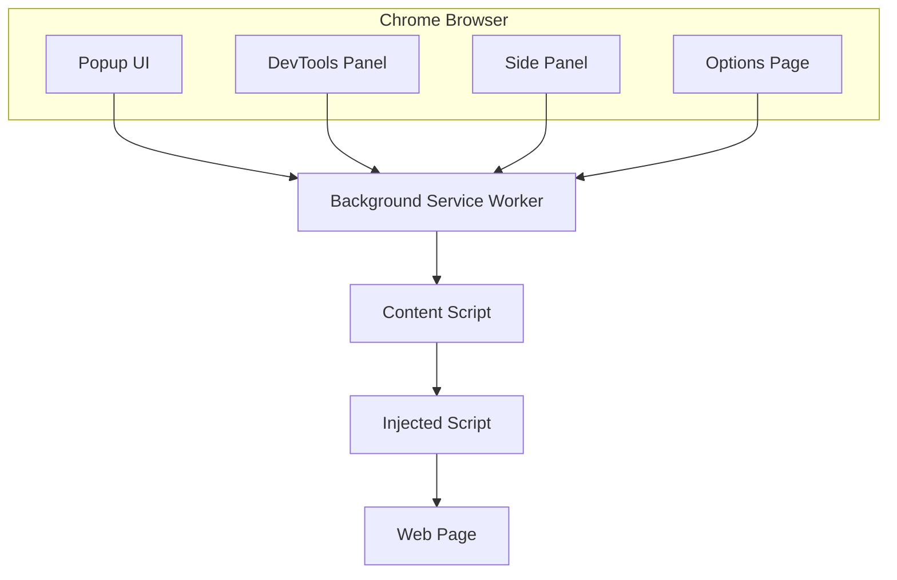

# Web Vitals Profiler — Architecture

## Overview

Web Vitals Profiler is a Manifest V3 Chrome extension built as a Turborepo monorepo. Each UI surface (popup, DevTools panel, side panel, options) is an independent React application that shares code through workspace packages.

## Context Diagram

## Extension Contexts

| Context | Purpose | Runs When |
|---------|---------|-----------|
| **Background SW** | Message hub, tab tracking, storage | Extension installed / events |
| **Content Script** | Bridge between page and extension | Every matched page load |
| **Injected Script** | Page-world PerformanceObserver access | Injected by content script |
| **Popup** | Quick vitals snapshot | User clicks toolbar icon |
| **Side Panel** | Persistent profiling view | User opens side panel |
| **DevTools** | Developer-grade profiling | DevTools open |
| **Options** | Settings and data management | User opens settings |

## Message Flow

1. **Popup** sends `PING` → **Background** responds `PONG`
2. **Content Script** sends `EXTENSION_READY` → **Background** acknowledges
3. **Injected Script** → `postMessage` → **Content Script** → `VITALS_UPDATE` → **Background**
4. **Module 2** will broadcast vitals to all listening UI contexts

## Package Boundaries

| Package | Responsibility |
|---------|---------------|
| `@wvp/types` | Shared TypeScript interfaces |
| `@wvp/messaging` | Cross-context message passing |
| `@wvp/performance` | Vital thresholds and monitoring |
| `@wvp/storage` | chrome.storage / IndexedDB (Module 3) |
| `@wvp/ui` | Shared React components + Tailwind |
| `@wvp/hooks` | React hooks for extension APIs |
| `@wvp/utils` | Logger, formatters, helpers |

## Why Monorepo?

- **Shared UI**: Popup, side panel, and DevTools reuse the same components
- **Type safety**: Single source of truth for message contracts
- **Independent testing**: Each package tests in isolation
- **Interview signal**: Demonstrates real-world extension architecture

## Module Roadmap

| Version | Module | Features |
|---------|--------|----------|
| v0.1 | Foundation | MV3, all UI surfaces, messaging |
| v0.2 | Performance | web-vitals, PerformanceObserver |
| v0.3 | DevTools | Live charts, timeline |
| v0.4 | Overlay | On-page vitals overlay |
| v0.5 | IndexedDB | Historical trends, regression detection |
| v1.0 | Release | Chrome Store, Firefox, landing page |
